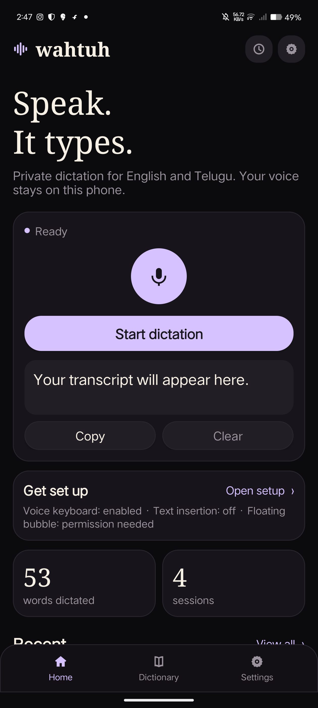

# Wahtuh Pho

**Speak. It types.** Offline-first dictation for Android, with a 90s arcade soul.

Wahtuh Pho is an independent, local-first voice keyboard and floating dictation bubble. It transcribes on your phone by default with Cactus Compute's 16.9 MB Whistle model, inserts text into other apps through an accessibility service, and keeps every raw transcript next to the cleaned result.

> Not affiliated with Wispr Flow. The interaction model is inspired by modern dictation apps; all app code, copy, and artwork here are original, including the arcade-inspired UI and 8-bit launcher icon.



## Why another dictation app?

Wispr Flow is excellent because it makes voice feel effortless: one bubble, any app, cleaned-up text, and tone that fits the destination. The catch is architectural: transcription always happens in the cloud, the app reads limited on-screen context, and the best experience is tied to a subscription and an account.

Wahtuh Pho keeps the effortless part and changes the ownership model:

- **Offline by default.** The 16.9 MB Whistle model runs on the phone. Local-only mode cannot open a network connection for transcription.
- **Bring your own cloud key, not a subscription.** Groq, Gemini, Deepgram, or OpenAI are optional accelerators, never a gate.
- **Inspectable cleanup.** The raw transcript and the cleaned result are stored side by side. Deterministic edits (fillers, punctuation, dictionary, snippets, email dictation) work without a cloud; AI polish is a separate, text-only pass.
- **No screen capture.** Bubble visibility uses only field metadata and the app package name. Field text is read at insertion, or by the opt-in **Field Context** toggle, which extracts only names/code terms for AI polish. Passwords are always refused. Privacy is enforced in code, not just promised in a policy.
- **It has a personality.** The whole app is a 90s arcade cabinet, including a fully offline Snake/Breakout/Pong easter egg.

**Positioning:** Wispr Flow makes voice feel magic. Wahtuh Pho makes it yours.

Wispr Flow's paid promise, our clean-room notes, and the feature gaps we deliberately do not copy are documented in [docs/WISPR_FLOW_RESEARCH.md](docs/WISPR_FLOW_RESEARCH.md).

## Status

- **Android app: v0.3.0.** Whistle local ASR, seven languages, verified insertion, snippets, writing styles, self-corrections, developer dictation, inline edit commands, selected-text Command Mode, local history retention, boot recovery, and optional cloud providers. Builds as an 18 MB APK. Text tests pass **51/51** and VAD checks **11/11**. The newest features still need a physical device pass; see [docs/FEATURE_PARITY.md](docs/FEATURE_PARITY.md) for the honest Wispr Flow comparison.
- **Rust core: scaffold + real local Whisper engine.** 74 workspace tests pass; the shipped APK has its own JNI bridge to Whistle and does **not** link the Rust crates.
- The Android app is Gradle-free and built with `aapt2`, `javac`, D8, and `apksigner`.

## What works

- **On-device Whistle ASR** — 16.9 MB CPU model from Cactus Compute. Supports English, German, French, Spanish, Italian, Dutch, and Polish; auto-detect or an explicit language. No Telugu.
- **90s arcade UI** — dark starfield, pixel type, sharp panels, bevel buttons, scanlines, and a four-tab home: Home, Words, Snips, Style.
- **Floating bubble** — draggable dark pixel pill with an animated waveform, live timer, and distinct recording/working/error states. It appears only when an editable text field and the keyboard are open. Drag it to the 5 MIN or 10 MIN X target to snooze the bubble.
- **Voice keyboard** — QWERTY/numbers IME with a Dictate button.
- **Verified cross-app insertion** — paste-first into the focused field, read back and verify, `ACTION_SET_TEXT` fallback, cursor placement, password-field refusal, and notification undo. If every path is refused, the text is copied instead.
- **Dictionary and snippets** — names, products, and spoken triggers that expand into full text.
- **Self-corrections and developer dictation** — "meet at five, actually six", "send it to John, I mean Jane", and "scratch that" resolve locally. Spoken `camel case`, `snake_case`, `PascalCase`, `kebab-case`, `dot.case`, and file tags become identifiers without a cloud call. Numbered lists are recognized from "first… second… third…".
- **Inline edit commands** — "delete the last sentence", "delete the last word", "make that a bullet list", "make that a numbered list", "make that uppercase", "make that lowercase", and "capitalize that" work locally with no cloud key.
- **Command Mode** — select text in any app, hold the bubble, and speak an edit. On-device it handles case changes, bullet/numbered lists, and deletes. A Groq, OpenAI, or Gemini key adds freeform rewrites such as "make this shorter". Only the selection changes, and the notification can undo it.
- **Local history controls** — KEEP, 24 HOURS, or NEVER. Choosing NEVER purges saved transcripts and any saved audio, and the 24-hour policy deletes old entries and old audio automatically.
- **Bubble controls** — small, normal, or large, with 60%, 80%, or 100% opacity.
- **Boot and battery resilience** — if the bubble was running, a boot receiver restores it after reboot, and Settings links to the battery-optimization exemption.
- **Writing styles + app-aware tone** — default, formal, casual, very casual, and excited. With Default selected, chat packages get casual punctuation and email packages stay formal using the foreground package name only; no screen contents are read. Styles also feed optional AI cleanup.
- **Cloud is opt-in** — Groq, Gemini, Deepgram, or OpenAI keys stored encrypted with the Android Keystore. Local-only mode blocks every cloud call. No silent fallback. AI polish status is visible on Home and in Settings, including when it is off or missing a key.
- **Seamless onboarding** — a single “press start” flow for choice of keys, provider, language, and permissions.

## Install

Requirements: Android 8.0 (API 26) or newer, arm64 device.

1. Download `wahtuh-pho-0.3.0.apk` from the GitHub Releases page.
2. `adb install -r wahtuh-pho-0.3.0.apk` (or open the file on the phone).
3. Open the app and follow the arcade setup:
   - Choose on-device or bring your own cloud key.
   - Pick one of the seven languages, or leave auto-detect on.
   - Allow the microphone and display over other apps; enable text insertion.
4. Tap **Launch bubble** on Home, then hold the bubble in any text field and talk.

The APK bundles the 16.9 MB model compressed inside the APK; the first dictation copies it once into app-private storage. No model download is required.

## Use

- **Home**: see word count, privacy mode, setup warnings, and recent transcripts. Copy or delete any run.
- **Bubble**: it appears when you focus an editable field. Hold to talk and release to transcribe/insert. Tap to start hands-free; tap again to stop. A session warns at four minutes and auto-transcribes at five. Drag to move, or drop it on the 5 MIN/10 MIN X to snooze. Use the notification's Undo action after an insertion.
- **Words**: add names or replacements. Each entry can be `Name=Replacement` or a single word.
- **Snips**: add `trigger=full text` expansions.
- **Style**: choose the tone used by cleanup.
- **Settings**: provider, encrypted key, language, permissions, AI polish, and transcript clearing.

## Measured on device

vivo V2251, Android 15 (SDK 35), arm64-v8a, 16 kHz mono. Whistle was measured through its CLI with two threads on cached runs:

| Clip | Audio | Wall time | Transcript |
|---|---:|---:|---|
| LibriSpeech `0.wav` | 3.65 s | 1.3–3.2 s warm | exact reference |
| `en1.wav` | ~4 s | warm | one substitution; worse than Whisper base on this clip |
| Telugu sample | 4.73 s | warm | romanised garbage; unsupported |

The first cold run was about 8.9 s while the model and caches loaded. These are CLI measurements, not in-app latency. See [docs/BENCHMARKS.md](docs/BENCHMARKS.md). Whistle quality varies by accent and microphone; test with your own voice.

## Build the Android app

Termux/Linux, Java 17+, Android SDK platform 35, no Gradle required.

```bash
export ANDROID_JAR=$HOME/asdk/android-35/android.jar
./scripts/fetch-deps.sh       # pinned D8
./scripts/fetch-models.sh     # Whistle model + SHA-256
./scripts/build-native.sh     # optional: rebuild JNI libs (Termux arm64)
./scripts/build.sh            # aapt2, javac, D8, zipalign, apksigner
```

Output: `build/wahtuh-pho-0.3.0.apk`. Override signing with
`WAHTUH_KEYSTORE`, `WAHTUH_KEY_ALIAS`, `WAHTUH_STORE_PASS`, `WAHTUH_KEY_PASS`.
Without them a local debug keystore is generated for testing only.

The prebuilt `app/jniLibs/arm64-v8a/` libraries are included, so `build.sh` does not need a C++ toolchain. `build-native.sh` documents the Termux rebuild path.

Run the dependency-free text tests with `./scripts/test.sh` (needs `ANDROID_JAR` only for compilation).

## Rust core

The `crates/` workspace contains the portable pipeline that predates the Android shell:
audio chunking, an engine trait with a whisper.cpp backend, normalization/dictionary,
provider request builders, local-only config, and session/history core.

```bash
cargo test --workspace
```

Research and design notes live under [docs/](docs/): [architecture](docs/ARCHITECTURE.md),
[project status](docs/PROJECT_STATUS.md), [engine evaluation](docs/ENGINE_EVALUATION.md),
and [Wispr Flow research](docs/WISPR_FLOW_RESEARCH.md).

## Privacy

- On-device mode never opens a network connection for transcription.
- Cloud providers are only used when you explicitly select one and turn local-only off.
- Cloud audio is sent as a standard multipart/JSON transcription request. Optional cleanup sends final text only; when transcription is Deepgram, the app can reuse your configured Groq, OpenAI, or Gemini key for that separate polish request. If **Field Context** is enabled, AI polish also receives a short list of extracted names/code terms, never the surrounding prose.
- API keys are encrypted with an Android Keystore AES/GCM key and never logged.
- History and optional recordings live in app-private storage. Clear history from Settings; recordings are not deleted by that action.

Full details: [docs/PRIVACY.md](docs/PRIVACY.md) and [docs/ANDROID_APP.md](docs/ANDROID_APP.md).

## Known limitations

- Whistle supports seven languages only. Telugu is intentionally absent because the model does not transcribe it.
- Local accuracy was evaluated on a small set of clips. Accents, noisy rooms, and code-switching remain under-tested.
- Insertion overwrites the clipboard by design and cannot be verified in fields that hide their text (some WebViews). Notification undo only works while the field still matches the inserted result.
- Freeform Command Mode ("make this professional") requires a cloud key and an internet connection; local Command Mode covers case, list, and delete edits. It replaces the selection only if the selected text still matches what was read when recording began.
- Transcription is batch, not streaming. Words appear after release rather than as you speak.
- On-device language breadth is seven languages. Cloud auto-detect can cover more, but there is no local Hinglish or Telugu model.
- Sideloaded v0.3.0, not a Play Store release. No account or sync.
- App-aware tone covers common chat/email packages and falls back to the selected Default style elsewhere. It uses the package name only, never screen contents. Field Context is a separate opt-in switch, off by default, and requires AI polish.
- Self-correction heuristics are intentionally conservative; ambiguous corrections still rely on AI polish. Whistle's local accuracy remains the main precision limit.

## License

Apache-2.0. Third-party components, fonts, and model licenses are listed in [THIRD_PARTY_NOTICES.md](THIRD_PARTY_NOTICES.md).
